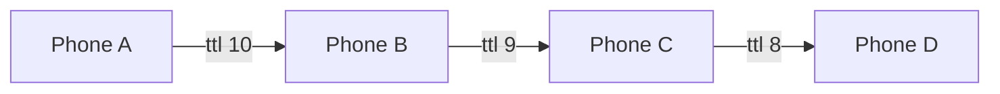

# NoBars

[](https://github.com/Swastikkkkk/NoBars/actions/workflows/build.yml)
[](https://github.com/Swastikkkkk/NoBars/releases/latest)
[](LICENSE)

**Website:** https://swastikkkkk.github.io/NoBars/

Offline peer-to-peer mesh for iPhone and Android. Phones find each other over Bluetooth and peer-to-peer Wi-Fi, form a mesh, and relay chat, live location and SOS alerts across multiple hops, even with the app in the background. iPhones can also call each other, directly or through other phones.

No internet, no cell signal, no server. Built for places where networks fall over: concerts, festivals, treks, disaster zones.

**[Download for Android](https://github.com/Swastikkkkk/NoBars/releases/latest/download/NoBars.apk)** · **[Download for iPhone (IPA)](https://github.com/Swastikkkkk/NoBars/releases/latest/download/NoBars-unsigned.ipa)** · [Website](https://swastikkkkk.github.io/NoBars/) · [How to install](#install)

<p align="center">
  
  
  
  
  
</p>

## What it does

| Feature | How it works |
|---|---|
| **Multi-hop chat** | Every packet carries a TTL of 10. Each phone re-sends it to its neighbours except the one it came from, so a message reaches people far outside the sender's range. A seen-packet cache drops loops and duplicates, so everyone gets it exactly once. |
| **Store and forward** | Send with nobody around and the message is queued, then delivered the moment a buddy connects. Queued messages and chat history are saved on the phone, so closing the app loses nothing. |
| **SOS** | One tap floods your live location to the whole group every 5 seconds, even with the screen locked. Buddies get an alert, a red pin and a compass pointing at you. Stopping SOS sends an all-clear. |
| **Buddy map and compass** | Bearing and distance to every buddy who is sharing location. |
| **Voice and video calls** | Direct calls stream raw PCM audio and JPEG video over `MCSession` byte streams, one per direction. No WebRTC, no signalling server. |
| **Calls through the mesh** | Out of direct range? The call hops through other phones: audio is cut to 8 kHz mu-law, sent in signed, sealed 160 ms chunks, and played in order on the other end. Audio only, iPhone to iPhone. |
| **Works in the background** | Alongside MultipeerConnectivity, phones also link over Bluetooth LE, which iOS keeps running when the app is closed or the phone is locked. Chat and SOS keep relaying, and you get a notification. |
| **Android** | A native Android app speaks the same Bluetooth LE protocol, encryption and signatures, so Android phones mesh with iPhones: chat, live location and SOS. |
| **Private groups** | Phones only connect when their group codes match. The code itself is never broadcast, and every packet is encrypted with a key derived from it (see [Security](#security)). |
| **Signed identities** | Each phone has its own signing key. Buddies pin it the first time they meet, so nobody can send chat or a fake SOS under your name. |
| **Auto reconnect** | If a buddy drops and comes back into range, the app re-scans and reconnects on its own. |
| **System integration** | Live Activity and Dynamic Island, a Mesh Status widget, a Control Center SOS button, and Siri / Shortcuts actions. |

### How the relay works



A and D are never in range of each other. The message still arrives, exactly once. This logic is tested on every push by a simulation that runs the app's real packet and router code over chains, loops and a 15-phone line (see `Tests/RelaySimulation`).

Every push also runs an end-to-end test on two iOS simulators with the real MultipeerConnectivity stack: discovery, encrypted connect, chat both ways, SOS flood, drop detection with auto re-scan, and group isolation (see `Tests/sim-mesh-test.sh`).

## Install

You need **at least two phones**: iPhones on iOS 26 or later, Android phones on Android 10 or later, in any mix. Simulators and emulators have no Bluetooth, so they can't form a mesh.

### Android

Download [`NoBars.apk`](https://github.com/Swastikkkkk/NoBars/releases/latest/download/NoBars.apk) (always the latest version), open it on the phone and allow installing from your browser when asked. Open NoBars, pick a name and the same group code as your friends, and allow **Nearby devices**, **Location** and **Notifications**. A "NoBars mesh is live" notification means it's running, including with the screen off.

To build it yourself: `cd android && ./gradlew :app:assembleRelease` (needs JDK 17 and the Android SDK).

### iPhone

#### Option A: build with Xcode (Mac)

1. Install **Xcode 26** or newer.
2. Clone and open:
   ```bash
   git clone https://github.com/Swastikkkkk/NoBars.git
   cd NoBars
   open NoBars.xcodeproj
   ```
3. Select the **NoBars** target, go to **Signing & Capabilities** and pick your team. Do the same for the **WidgetExtension** target.
4. If you're not on the original developer team, change the bundle IDs so they're unique to you:
   - `com.swastik.nobars` on NoBars
   - `com.swastik.nobars.Widget` on WidgetExtension (must start with the app's ID)
   - the App Group `group.com.swastik.nobars` on both targets, plus the same string in `NoBars/SharedStore.swift` and `Widget/Widget.swift`
5. Plug in an iPhone, pick it as the run destination, press **Run**. On the phone, trust the developer under **Settings > General > VPN & Device Management** the first time.
6. Repeat on the second phone.

> **Free Apple ID (Personal Team)?** It can't use App Groups. Remove the **App Groups** capability from both targets and the app works fully. Only the home screen widget stays empty, since it can't read the app's data.

#### Option B: no Mac (Windows or Linux)

Every release ships an unsigned IPA.

1. Download `NoBars-unsigned.ipa` from the [latest release](https://github.com/Swastikkkkk/NoBars/releases/latest). (Every push also builds one under [Actions](https://github.com/Swastikkkkk/NoBars/actions/workflows/build.yml) > Artifacts if you want the newest commit.)
2. Install [Sideloadly](https://sideloadly.io) or AltStore, connect your iPhone, drop in the IPA and sign in with your Apple ID.
3. On the phone, trust the developer under **Settings > General > VPN & Device Management**.

Free Apple IDs re-sign apps every 7 days, so you'll need to reinstall weekly.

## First run

1. Open the app, enter your name and a **group code** (anything, like `fest24`). Leave it blank to join the open mesh.
2. Allow **Local Network**, **Location** and **Microphone** when asked. Without Local Network, phones can't see each other.
3. Do the same on the second phone with the **same group code**.

## Prove it works

Turn off **Wi-Fi network** and **Mobile Data** on every phone (keep Bluetooth on, and leave the Wi-Fi radio enabled in Control Center but not joined to any network).

| Test | Expected |
|---|---|
| Open the app on two phones, same group | "<name> joined the mesh" within a few seconds |
| Send a chat message | Shows on the other phone |
| Send a message with no one connected, then bring a phone close | Message shows "queued", then delivers on connect |
| Three phones: A, B, C with A and C far apart (different floors), B in between | A's messages reach C through B |
| Tap the phone icon on a buddy | Both phones go into a call, audio both ways |
| Turn on video in the call | Both cameras stream |
| Tap the location icon (SOS) on one phone | Others get an SOS alert and a red pin; compass points to it |
| Stop SOS | The red pin clears on other phones |
| Walk out of range and back | Buddy reconnects without restarting the app |
| Different group codes | Phones never connect |
| A, B, C in a line, call C from A (A and C out of range) | C rings "via mesh", audio both ways through B |
| Lock the iPhone, send it a chat from another phone | Notification arrives; it still relays onward |
| Android phone in the same group | Shows up as a buddy; chat and SOS work both ways with iPhones |

Settings > Diagnostics shows a live log of discovery, invites and connections if anything misbehaves.

## Shortcuts, Siri, widget, Control Center

- **Siri:** "Go live on NoBars" or "Send SOS on NoBars". Both also appear in the Shortcuts app and can be put on the Action button.
- **Control Center:** add the **Mesh SOS** control. One tap opens the app and starts SOS.
- **Widget:** add **Mesh Status** (small or medium) to see how many buddies are nearby and any active SOS.
- **Live Activity:** shows your nearest buddy and distance on the Lock Screen and Dynamic Island while the mesh is live.
- Deep links: `nobars://sos` and `nobars://open`.

## Security

| Threat | What stops it |
|---|---|
| Someone nearby reading your group code off Bluetooth | Phones advertise a one-way tag of the code (SHA-256 stretched 50,000 rounds, then HKDF and HMAC), never the code. |
| A phone that copies the tag and connects | Every packet is sealed with ChaCha20-Poly1305 under a key derived from the code. Right after linking, both phones swap an encrypted, signed hello. A phone that can't produce one is dropped within 10 seconds, before it can chat, see locations or call. |
| A group member sending as someone else, or faking an SOS | Each phone signs every packet with its own Curve25519 key, stored in the Keychain. The first key seen for a name is pinned. A different key for that name is rejected. |
| A relay editing a message or SOS in transit | The signature covers everything but the hop counter, and the encryption is authenticated. Any change is rejected. |
| Replaying old location or SOS packets | Location and hello packets older than 10 minutes are dropped, and every packet id is only accepted once. |

What it doesn't do: everyone with the group code can read the group's chat, since it's a group chat. Use a long, unguessable code for anything private, because a short one can be guessed from the tag offline. If a friend reinstalls the app their key changes, so tap **Settings > Reset trusted buddies**. Settings also shows your key fingerprint so you can compare in person.

## Limits to know

- **Background is Bluetooth only.** iOS suspends MultipeerConnectivity when the app isn't open, so in the background iPhones relay over Bluetooth LE: slower, shorter range, and no calls. Open the app for the full-speed Wi-Fi mesh.
- **A backgrounded iPhone is invisible to Android.** iOS hides background Bluetooth adverts from non-Apple phones. Android still reaches it when the iPhone has the app open, or through another phone.
- **Calls are iPhone only.** Relayed calls need Wi-Fi links between every hop, which Android doesn't have here. Video is direct only. Each hop adds some delay.
- **Up to 8 direct Wi-Fi links per iPhone** (an Apple limit per session). Bluetooth LE and multi-hop relaying are how the mesh grows past that.
- **Names should be unique** within a group, since peers are identified by display name.
- Range is roughly 10 to 30 m per hop on Bluetooth, more on peer-to-peer Wi-Fi, depending on walls and crowds.

## Tech

| Layer | Tech |
|---|---|
| Discovery and transport | MultipeerConnectivity (Bluetooth + peer-to-peer Wi-Fi), encryption required, plus CoreBluetooth GATT for background and Android |
| Packets and routing | Codable `MeshRelayPacket` (stable `id`, `ttl`, `kind`), `MeshRouter` for dedupe and forwarding |
| Security | CryptoKit: ChaCha20-Poly1305, Curve25519 signatures, HKDF, Keychain |
| Android | Kotlin, Jetpack Compose, Bluetooth LE GATT server and client in a foreground service, BouncyCastle for the same crypto |
| Protocol | [protocol/PROTOCOL.md](protocol/PROTOCOL.md), with test vectors both apps are checked against |
| Calls | AVAudioEngine and AVCapture over `MCSession` streams |
| Location | CoreLocation, MapKit |
| System | ActivityKit, WidgetKit, ControlWidget, App Intents |
| UI | SwiftUI, Observation |

## Project structure

```
NoBars/
  ViewModels/MeshConnectivityManager.swift   discovery, sessions, relay, outbox, SOS, reconnect
  Models/MeshRelayPacket.swift               packet, seen cache, router
  Models/MeshCrypto.swift                    group keys, sealing, signatures, key pinning
  MeshIdentity.swift                         this phone's signing key (Keychain)
  MeshBLETransport.swift                     Bluetooth LE links (background, Android)
  RelayCallAudio.swift                       8 kHz mu-law audio for calls through the mesh
  Models/BLEFraming.swift                    splitting packets into Bluetooth LE frames
  ChatStore.swift                            chat history and queued messages on disk
  MeshVoiceCallManager.swift                 voice and video calls
  LiveActivityController.swift               Live Activity and Dynamic Island
  AppIntents.swift                           Siri and Shortcuts actions
  SharedStore.swift                          App Group data for the widget
  Views/                                     dashboard, chat, map, compass, call, onboarding
Widget/                                      Mesh Status widget, SOS control, Live Activity UI
android/core/                                protocol in plain Kotlin (packets, routing, crypto, framing) + tests
android/app/                                 Android app: Bluetooth LE transport, mesh engine, Compose UI
protocol/                                    wire format spec, Python reference, cross-platform test vectors
Tests/MeshCoreTests/                         unit tests for routing and crypto (swift test, runs in CI)
Tests/RelaySimulation/                       multi-hop relay simulation (runs in CI)
Tests/sim-mesh-test.sh                       two-simulator end-to-end mesh test (runs in CI)
.github/workflows/build.yml                  builds the app, runs the simulation, packages the IPA
```

Run the unit tests and the relay simulation yourself on a Mac:

```bash
swift test
```

```bash
xcrun swiftc NoBars/Models/MeshRelayPacket.swift Tests/RelaySimulation/main.swift -o relay-sim && ./relay-sim
```

## Troubleshooting

- **Phones never find each other:** check Settings > Privacy & Security > Local Network > NoBars is on, both phones use the exact same group code, and Bluetooth is on.
- **"Local Network access is off" banner:** same fix as above, then reopen the app.
- **No audio in a call:** allow Microphone in Settings > NoBars.
- **Widget shows 0 or nothing:** you're on a free team without App Groups, or the app hasn't been opened since install.
- **Live Activity missing:** Settings > NoBars > Live Activities must be on.
- **Android doesn't see anyone:** allow Nearby devices and Location for NoBars, turn Bluetooth on, and check the group code. Some phones kill background apps: set NoBars' battery usage to Unrestricted.
- **iPhone stops relaying in the background:** make sure Bluetooth is on and NoBars is allowed Bluetooth in Settings > NoBars.

## License

[MIT](LICENSE)
